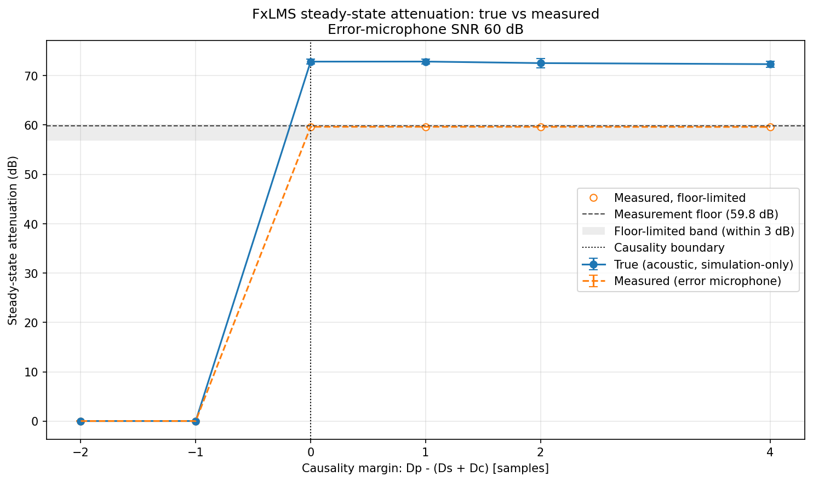
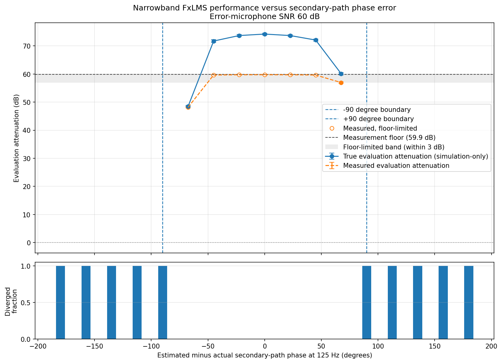
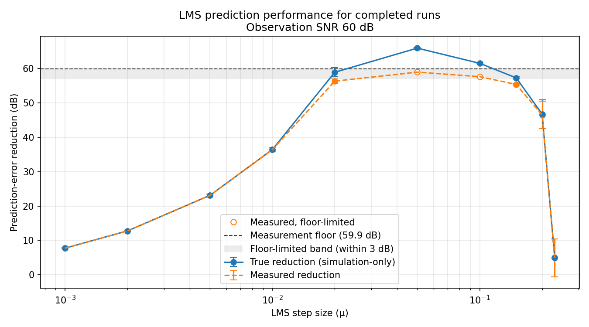

# Results

## Measurement floor: true vs measured attenuation

### Why this section exists

The original simulations were noise-free. The disturbance was generated by an
FIR primary path and the controller is an FIR filter, so the residual could
shrink to floating-point rounding level. This produced figures such as
89 dB (causality sweep), 255 dB (phase-error sweep) and 179 dB (LMS step-size
sweep). These numbers are correct arithmetic, but no physical system could
measure them: a real error microphone adds self-noise, preamp noise and
ADC noise.

### Model

The error-microphone signal is modelled as

    r[n]   = d[n] + y_s[n]     acoustic residual (simulation-only)
    e_m[n] = r[n] + v[n]       measured error, seen by the controller

where v[n] is white Gaussian noise. The controller adapts on e_m[n], never on
r[n]. For the direct-error LMS experiment, the noise is added to the
observation of the desired signal, which gives the same form
(measured error = true error + v).

The noise level is set as an SNR relative to the uncontrolled disturbance:

    SNR_dB = 20 log10( RMS(d) / RMS(v) )

**Assumption:** SNR = 60 dB is the reference value; 40 dB is used as a
sensitivity check. These are modelling choices, not measured properties of a
specific sensor.

### Reported quantities

| Quantity | Definition | Observable in a real system? |
|---|---|---|
| True attenuation | 20 log10( RMS(d) / RMS(r) ) | No (simulation only) |
| Measured attenuation | 20 log10( RMS(d+v) / RMS(r+v) ) | Yes |
| Measurement floor | 20 log10( RMS(d+v) / RMS(v) ), approx. equal to the SNR | Yes |
| Floor-limited | Measured value within 3 dB of the floor | — |

The 3 dB margin follows from power addition: when the residual power equals
the noise power, the measured value lies exactly 3.01 dB below the floor. A
floor-limited result therefore describes the sensor rather than the
controller.

**Interpretation rule:** true values are used for design decisions; measured
values are used for performance claims.

Noise-free results are kept unchanged in their original result folders and
are labelled "idealised sensor".

---

### Finding 1: Causality sweep

Config: `configs/step3_causality_sweep_snr60.yaml`, 5 seeds, white-noise
reference, matched secondary path, μ = 0.005.

| Causality margin | Steady-state, noise-free | Steady-state true @ 60 dB | Measured @ 60 dB | Floor-limited |
|---|---|---|---|---|
| −2 | 0.03 dB | 0.03 dB | 0.03 dB | 0/5 |
| −1 | 0.03 dB | 0.03 dB | 0.03 dB | 0/5 |
| 0 | 89.28 ± 4.77 dB | 72.83 ± 0.47 dB | 59.63 ± 0.13 dB | 5/5 |
| +1 | 89.34 ± 4.91 dB | 72.84 ± 0.52 dB | 59.63 ± 0.13 dB | 5/5 |
| +2 | 84.53 ± 4.49 dB | 72.53 ± 0.95 dB | 59.62 ± 0.12 dB | 5/5 |
| +4 | 81.87 ± 4.17 dB | 72.32 ± 0.60 dB | 59.60 ± 0.14 dB | 5/5 |

- Causality still decides whether cancellation is possible (about 0 dB vs about 73 dB).
- The noise-free differences between margins 0 and +4 (89 vs 82 dB) do not
  survive a 60 dB sensor: all measured values are floor-limited at about 59.6 dB.
- The seed-to-seed spread fell from about ±4.8 dB to about ±0.5 dB. The
  noise-free spread was rounding error at the 1e-5 residual level, not real
  variation between seeds.
- With a floor, the residual settles, and the operational convergence time
  becomes measurable. Measured convergence time: 0.54 s (margin −2 to −1),
  2.44 s (margin 0 to +1) to 2.76 s (margin +4), mean of n=5 seeds per margin.
  Noise-free, the residual kept decreasing and no convergence time was found.

### Finding 2: Secondary-path phase error

Config: `configs/step3_phase_error_sweep_snr60.yaml`, 5 seeds, 125 Hz tone,
actual secondary delay 8 samples, μ = 0.005.

| Phase error | Steady-state, noise-free | Steady-state true @ 60 dB | Measured @ 60 dB |
|---|---|---|---|
| 0° | 255.50 dB | 73.71 ± 0.42 dB | 59.65 dB |
| −22.5° / +22.5° | 255.48 / 255.49 dB | 73.06 / 73.27 dB | 59.62 / 59.62 dB |
| −45° / +45° | 255.45 / 255.44 dB | 70.91 / 71.76 dB | 59.50 / 59.54 dB |
| −67.5° / +67.5° | 220.99 / 255.29 dB | 64.77 / 66.44 dB | 58.65 / 58.96 dB |
| ±90° and beyond | diverged (5/5) | diverged (5/5) | — |

All stable conditions at 60 dB are floor-limited (5/5).

- **The stability boundary does not move.** It lies between 67.5° and 90°
  with and without sensor noise. Divergence is a property of the algorithm's
  phase condition, not of the sensor.
- **Phase error has a real cost that the noise-free simulation hid.** True
  steady-state attenuation falls from 73.7 dB at 0° to about 65 dB at ±67.5°.
  Noise-free, every stable condition sat at about 255 dB.
- **A real microphone would barely see this cost:** the 9 dB true degradation
  appears as about 1 dB in the measured values.
- The noise-free figure keeps its labelled 60 dB display ceiling; the noisy
  figure needs none, because the sensor floor is the physical ceiling.

### Finding 3: LMS step size

Configs: `configs/step2_lms_step_size_sweep_coarse*.yaml` and
`configs/step2_lms_step_size_sweep*.yaml` (refined grid), 5 seeds, white-noise
reference σx = 0.5, L = 32, evaluation window 0.5–4.0 s. Direct-error system
identification, not acoustic ANC.

| μ | Noise-free | True @ 60 dB | Measured @ 60 dB | True @ 40 dB | Measured @ 40 dB |
|---|---|---|---|---|---|
| 0.001 | 7.74 | 7.74 | 7.74 | 7.74 | 7.74 |
| 0.01 | 36.42 | 36.42 | 36.39 | 36.34 | 34.72 |
| 0.02 | 59.21 | 58.88 | 56.30 | **49.92** | 39.49 |
| 0.05 | 116.70 | **65.90** | 58.93 | 45.90 | 38.93 |
| 0.10 | **179.32** | 61.47 | 57.59 | 41.47 | 37.59 |
| 0.15 | 163.44 | 57.25 | 55.34 | 37.25 | 35.34 |
| 0.20 | 100.00 | 46.73 | 46.47 | 26.73 | 26.47 |

All values are mean prediction-error reduction in dB over completed runs
(survivor-only).

**The best step size depends on the sensor.**

| Observation | Best μ |
|---|---|
| noise-free | 0.10 |
| SNR 60 dB | 0.05 |
| SNR 40 dB | 0.02 |

Below the optimum, performance is convergence-limited and all three columns
agree (μ ≤ 0.01). Above it, performance is limited by misadjustment: gradient
noise from v[n] makes the weights jitter, increasingly so with larger μ. The
noise-free sweep rewarded convergence speed only.

**The divergence boundary moves down with noise** (refined grid):

| Sensor | First μ with a diverged run | First μ with 5/5 diverged |
|---|---|---|
| noise-free | 0.235 (3/5) | 0.245 |
| SNR 60 dB | 0.23 (2/5) | 0.24 |
| SNR 40 dB | 0.22 (1/5) | 0.23 |

**Revised recommendation:** for this configuration, μ ≈ 0.05 at an observation
SNR of 60 dB (μ ≈ 0.02 at 40 dB). The earlier recommendation of μ = 0.10 holds
only for a noise-free observation. This value is not transferred to FxLMS,
whose filtered-reference power differs.

### Theory checks

Two textbook LMS results, evaluated for σx² = 0.25 and L = 32 (Lσx² = 8),
agree with the simulation:

- **Stability bound** μ < 2 / (Lσx²) = 0.25. Empirically, the first divergence
  appears at 0.235 and total divergence at 0.245 (noise-free).
- **Misadjustment** M = (μLσx²/2) / (1 − μLσx²/2); predicted true reduction is
  approximately SNR − 10 log10(M):

| μ | M | Predicted @ 60 dB | Simulated @ 60 dB |
|---|---|---|---|
| 0.05 | 0.25 | 66.0 dB | 65.9 dB |
| 0.10 | 0.67 | 61.8 dB | 61.5 dB |
| 0.15 | 1.50 | 58.2 dB | 57.3 dB |
| 0.02 (@ 40 dB) | 0.087 | 50.6 dB | 49.9 dB |

Agreement is within about 1 dB up to μ = 0.15; the approximation degrades
near the stability edge, as expected.

### Not re-run with sensor noise

| Experiment | Reported attenuation | Expected effect of a 60 dB floor |
|---|---|---|
| Step 1 fixed FIR | 24.4 dB | Negligible: the residual is about 35 dB above the noise |
| Step 3.1 FxLMS mismatch | 18.8 dB eval / 24.4 dB steady | Negligible (same reason) |
| Step 4 benchmark | 18.8–24.4 dB | Negligible (same reason) |
| Step 2.1 LMS signal variants | 7.7–84.2 dB | The single-tone 84 dB is idealised and would be floor-limited |

"Negligible" follows from power addition: with the residual 35 dB above the
noise, the measured value differs from the true one by less than 0.01 dB.

### Limitations

- White Gaussian sensor noise only; no quantisation model, no coloured or
  impulsive noise.
- One SNR reference value (60 dB) plus one sensitivity value (40 dB).
- The floor-limited flag uses a fixed 3 dB margin.
- 5 seeds per condition; standard deviations are sample estimates from 5 runs.
- The LMS step-size results come from a direct-error identification setup,
  not from acoustic ANC.